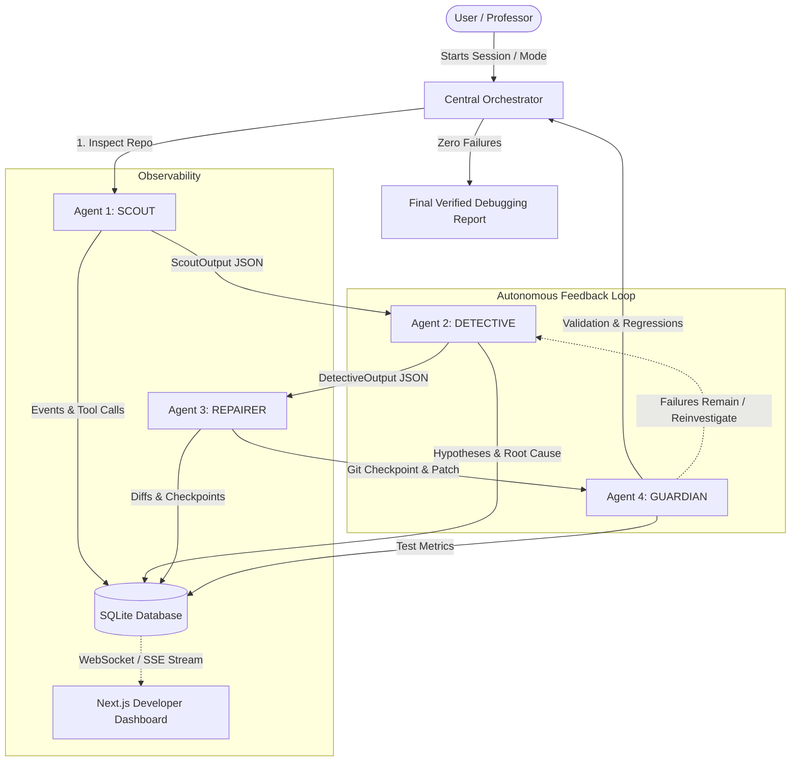

# System Architecture & Technical Design

**AUTONOMOUS CODE DEBUGGING AGENT**  
*Agentic AI Multi-Agent Self-Healing Architecture*

---

## 1. High-Level System Architecture

The Autonomous Code Debugging Agent is structured around **four primary AI agents**, a lightweight **Central Orchestrator**, a **Secure Sandbox Driver**, and an **Observability & Real-Time Streaming Subsystem**.

---

## 2. The Four Specialized Agents

| Agent | Name | Role & Responsibility | Core Tools |
| :--- | :--- | :--- | :--- |
| **Agent 1** | **SCOUT** | Repository inspection, language/framework detection, baseline test execution, stack trace isolation. | `list_files`, `detect_project_type`, `analyze_dependencies`, `run_tests`, `inspect_error_log` |
| **Agent 2** | **DETECTIVE** | Source code inspection, call-site tracing, hypothesis generation, evidence gathering, root cause deduction. | `read_file`, `search_code`, `get_file_metadata` |
| **Agent 3** | **REPAIRER** | Enforces safety rules, creates Git checkpoints, generates minimal safe patches, applies diffs. | `read_file`, `create_git_checkpoint`, `apply_patch`, `get_git_diff`, `rollback_changes` |
| **Agent 4** | **GUARDIAN** | Sandboxed test execution, test comparison, regression detection, rollback coordination, verification decision. | `run_tests`, `get_test_results`, `get_git_diff`, `rollback_changes` |

---

## 3. Central Orchestrator & State Machine

The Central Orchestrator is **not** an agent; it is a deterministic workflow engine responsible for:
- Enforcing safety boundaries (`MAX_ITERATIONS = 5`, timeouts, and security policies).
- Managing session state:
  `INITIALIZING` → `ANALYZING_REPOSITORY` → `RUNNING_TESTS` → `ANALYZING_FAILURE` → `INVESTIGATING_ROOT_CAUSE` → `GENERATING_PATCH` → `APPLYING_PATCH` → `VALIDATING_PATCH` → `RETRYING` → `FIXED` (or `HUMAN_INTERVENTION_REQUIRED`).
- Routing structured contracts between agents.
- Human-in-the-loop coordination (`AUTO` vs `APPROVAL_REQUIRED`).

---

## 4. Sandboxed Execution Layer

Untrusted uploaded repository code is strictly prohibited from running uncontrolled on host machines:
1. **DockerSandboxDriver**: Containerized execution with `--cpus=1.5`, `--memory=512m`, `--pids-limit=100`, read-only mounted filesystems, and unprivileged user.
2. **ProcessSandboxDriver**: Isolated subprocess executor with strict asynchronous timeouts, `validate_safe_path` directory boundary validation (anti-ZipSlip/traversal), and environment variable sanitization (API keys and credentials stripped).
3. **Sandbox Factory**: Automatically detects environment capabilities, provisioning Docker when available and falling back to secure subprocess isolation.

---

## 5. Database Schema & Data Models

Managed via **SQLAlchemy** on **SQLite**:
- `Project`: Project metadata, workspace location, detected languages and frameworks.
- `DebugSession`: Session ID, status, active agent, iteration counter, checkpoints.
- `AgentEvent`: Comprehensive event ledger (tool calls, tool results, state changes, timestamps).
- `ErrorRecord`: Failing assertions, stack frames, error types.
- `Hypothesis`: Competing explanations with confidence scores and evidence strings.
- `Patch`: Generated diffs, modified files, checkpoint tags, patch statuses.
- `TestRun`: Test suite metrics before and after repair (passed, failed, regressions).
- `DebugReport`: Final verified report containing before/after comparisons and confidence.
